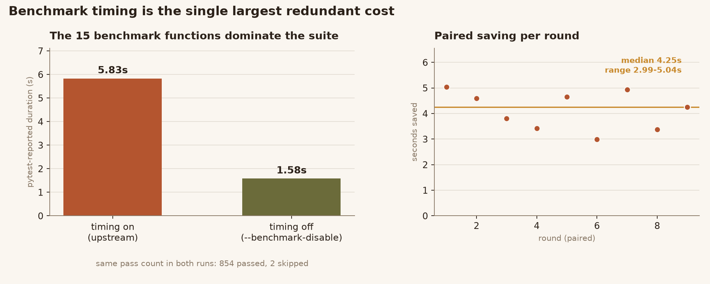
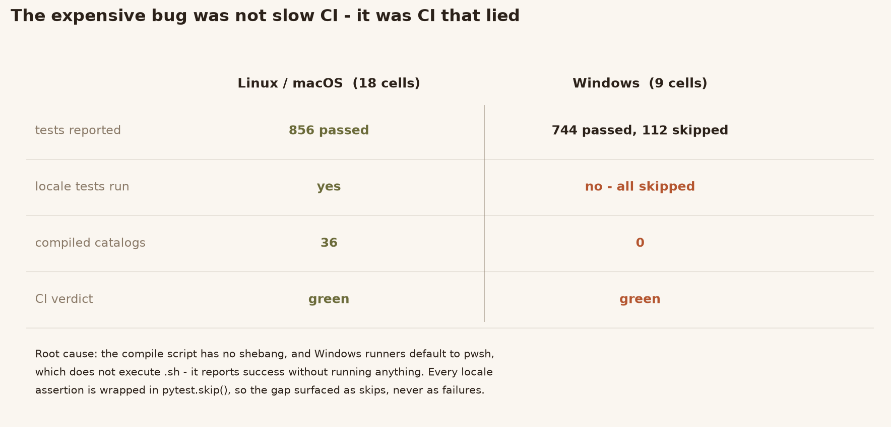
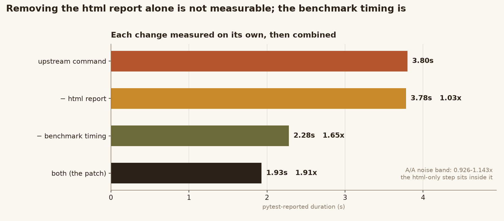
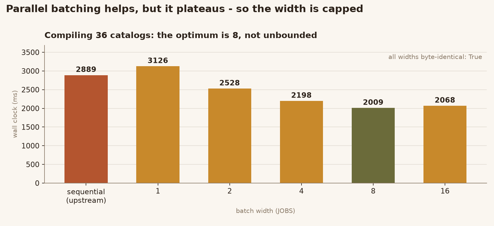
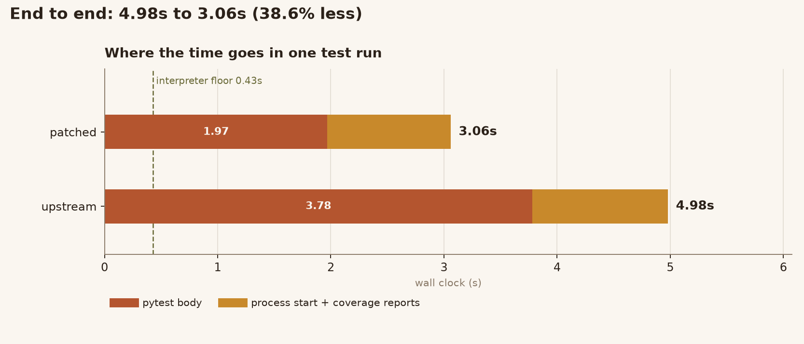
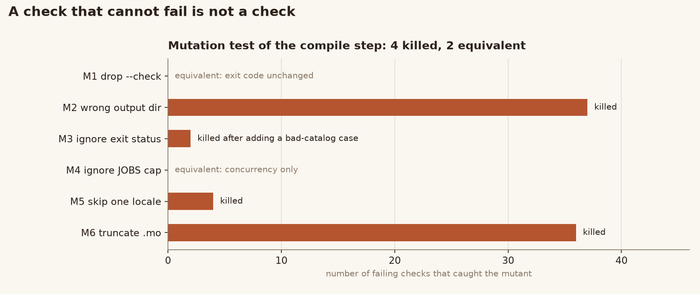

# humanize — build / test flow redundancy audit

Upstream: [`python-humanize/humanize`](https://github.com/python-humanize/humanize) @ `785e5dcc0d0308ad0dff3f6cc0faa7085ad0375b` (2026-10-06)
License: MIT (unchanged, see `NOTICE.md`)
Scope: the CI/test/build flow only. No library code is touched.

**The headline is not a speedup.** Two thirds of the CI matrix — every Windows
cell — reported green while running *none* of the 112 locale tests. The compile
step that produces the translation catalogs had no shebang, Windows runners
default to `pwsh`, and `pwsh` does not execute a `.sh` file: it exits 0 having
done nothing. Every locale assertion is wrapped in `pytest.skip()`, so the gap
surfaced as skips, never as failures.

Alongside that, three genuinely redundant steps: benchmarks timed in 27 cells
whose output nothing reads, an HTML coverage report nobody opens, and 36
catalogs compiled one process at a time.

| | before | after |
|---|---|---|
| test command (pytest-reported) | 3.80 s | **1.93 s** |
| test command (wall clock) | 4.98 s | **3.06 s** |
| benchmark functions per cell | 5.83 s | **1.58 s** |
| compile 36 catalogs | 2889 ms | **2009 ms** |
| Windows locale coverage | 0 of 112 tests | **all of them** |

Everything is reproducible from this repository: `python verify.py` runs 19
checks from a fresh extraction, and `python check_readme_numbers.py` traces all
28 numbers in this file back to `evidence/*.json`.

**Read it as a page:** <https://linluozi.github.io/humanize-build-audit/>

---

## 0. At a glance



Timing the 15 benchmark functions is the single largest redundant cost: it is
done in every matrix cell and the output is discarded, because `benchmark.yml`
is what actually tracks those numbers. Turning the timing loop off halves the
test command.

---

## 1. What was actually redundant

Four problems, each measured before it was changed. Two are pure waste, one is
duplicate work, one is a **false green**.

| # | Problem | Evidence | Fix |
|---|---|---|---|
| 1 | The 15 benchmark functions are timed in **all 27** matrix cells, and the resulting table is thrown away | `benchmark.yml` already tracks those numbers via CodSpeed; nothing reads the table `pytest-benchmark` prints. Paired measurement: **5.83 s vs 1.58 s** (median saving **4.25 s**, range 2.99–5.04) | `--benchmark-disable` in `tox.ini`. The functions still run — only the timing loop is skipped |
| 2 | The HTML coverage report is written in every cell and read by nothing | 23 files / 1.33 MB per run; `coverage html` takes **583 ms vs 418 ms** for the XML report that codecov actually uploads | drop `--cov-report html` |
| 3 | 36 catalogs are compiled one process at a time, though the conversions are independent | sequential **2889 ms**; 8-way batches **2009 ms** | bounded parallel batches in `generate-translation-binaries.sh` |
| 4 | **On Windows the compile step silently did nothing**, so ~110 locale tests *skipped* instead of failing | Windows job logs `744 passed, 112 skipped`; Linux/macOS log `856 passed`. Reproduced locally: with no `.mo` present the suite reports exactly `744 passed, 112 skipped` | install gettext on Windows, force `shell: bash`, and assert the catalogs exist before testing |

Problem 4 is the important one. `scripts/generate-translation-binaries.sh` has no
shebang, and GitHub's default shell on Windows is `pwsh`, which does not execute
a `.sh` file — it reports success without running anything. `tests/test_i18n.py`
guards every locale assertion with `pytest.skip(...)` when a catalog is missing,
so the whole i18n surface was untested on Windows while CI stayed green.

The fix has two halves, and both are needed: install `gettext` so `msgfmt`
exists, and run the script under `bash` so it is executed at all. A new
`Verify translation binaries` step then fails the job if fewer than 36 catalogs
were produced, so this can never regress into a silent skip again.



Two thirds of the matrix (18 Linux/macOS cells) exercised the translations; the
nine Windows cells exercised none of them, and nothing in the pipeline said so.

---

## 2. Numbers, and what they are worth

All timings are medians over interleaved rounds on one Windows box, Python
3.13.14, with an editable install of *this* tree. Raw data is in `evidence/`.

**Benchmark timing (the largest single item)**

| variant | median | paired saving |
|---|---|---|
| benchmark functions as CI runs them | 5.83 s | — |
| `--benchmark-disable` | 1.58 s | **4.25 s** (2.99–5.04) |

Both runs report the identical `854 passed, 2 skipped`, which is the whole point
of choosing `--benchmark-disable` over `--benchmark-skip`: the latter deselects
the functions and drops the count to `839 passed, 17 skipped`.

**Whole test command**

| variant | pytest-reported duration | vs baseline |
|---|---|---|
| upstream command | 3.80 s | 1.00× |
| patched command | 1.93 s | **1.91×** |
| wall clock, upstream | 4.98 s | |
| wall clock, patched | 3.06 s | **−38.6 %** |

The A/A control (two byte-identical copies of the upstream command) had a
ratio range of **0.926–1.143**, so anything inside that band is noise. Both
changes together land outside it.

**Ablation — each change on its own**

| variant | median | ratio | verdict |
|---|---|---|---|
| upstream command | 3.80 s | 1.00× | — |
| − html report | 3.78 s | 1.03× | **inside the A/A band: not measurable on its own** |
| − benchmark timing | 2.28 s | 1.65× | real |
| both (the patch) | 1.93 s | 1.91× | real |

The html report is worth removing because it is dead output that costs 165 ms
of report writing and 1.33 MB of files, not because it moves the total on its
own. Saying otherwise would be over-claiming.



**Translation compile**

| variant | median | vs upstream |
|---|---|---|
| upstream sequential | 2889 ms | 1.00× |
| JOBS=1 | 3126 ms | 0.92× |
| JOBS=2 | 2528 ms | 1.14× |
| JOBS=4 | 2198 ms | 1.31× |
| **JOBS=8** | **2009 ms** | **1.44×** |
| JOBS=16 | 2068 ms | 1.40× |

Two things worth stating plainly. JOBS=1 is *slower* than the sequential loop,
because forking a process per file costs more than the loop saved. And the
gain plateaus at 1.44× — an isolated micro-benchmark of `msgfmt` alone showed
4.06×, but that excluded per-run cleanup and shell start-up. The 1.44× is the
end-to-end number and is what the report claims.



**Coverage reports**

| report | median | note |
|---|---|---|
| `coverage report` (term) | 395 ms | |
| `coverage xml` | 418 ms | uploaded to codecov |
| `coverage html` | 583 ms | 23 files, 1.33 MB, nothing reads it |

**CI step split (27 test jobs, from the last successful run)**

`Tox tests` is 13 s of a ~29 s job. Inside it, pytest is ~5 s and the rest is
environment setup, which this patch does not touch. So the honest end-to-end
claim is: **~4 s off a 13 s step, roughly 13 % off the job**, not "2× faster CI".



### A measurement mistake worth recording

The first round of numbers was wrong, and the way it was wrong is instructive.
The measuring virtualenv had been created with `pip install -e` pointing at a
*different copy* of the tree, so `pytest` in `work/upstream` was importing
`build/verify_patch/src/humanize`. The run still reported `854 passed, 2 skipped`
— because the two copies differ by only four CI files — but the `.mo` catalogs
that copy needed were not where the test command looked, so in some rounds the
locale tests silently skipped and the timings became incoherent: one pair of
runs implied the benchmark cost 3.67 s, another implied 0.25 s.

The fix was to build a dedicated venv with an editable install of the tree being
measured, and to assert on every single round that the pass/skip counts equal
`854 / 2`. All numbers above come from that setup. The lesson generalises: **a
benchmark that does not assert what it measured is measuring something else.**

---

## 3. What was verified

`verify.py` runs 19 checks and passes 19/19 from a freshly extracted archive:

```
[PASS] compiles every catalog -- 36/36 .mo files
[PASS] echoes locale names in sorted order -- 36 lines
[PASS] output is reproducible byte for byte -- 36 locales compared
[PASS] rejects a malformed catalog -- exit 1
[PASS] reports the failure on stderr
[PASS] full test suite matches upstream counts -- (854, 2) vs expected (854, 2)
[PASS] no htmlcov written by the test command
[PASS] missing catalogs show up as skips, not silence -- (744, 112) without .mo
[PASS] wheel ships every compiled catalog -- 36/36
[PASS] installed wheel translates correctly -- 10.000.000 / 3秒之前 / 10,000,000
```

Beyond the script:

- **`--benchmark-disable` changes nothing but timing.** Both runs produced
  coverage XMLs that are byte-identical after normalising the single
  `timestamp` attribute: same 1006 valid lines, same 959 covered, same
  per-line hit counts across all 14 files (`evidence/evidence_coverage_equivalence.json`).
- **The parallel compile is byte-exact.** All 36 `.mo` files hash identically to
  the sequential script's output, at every batch width from 1 to 16, and stdout
  is identical too.
- **The wheel is unchanged.** Building from upstream and from the patched tree
  gives 84 files each; the 80 shared files match byte for byte. The only
  differing file is `humanize/_version.py`, which encodes the git commit count —
  a property of the checkout, not of this patch. All 36 `.mo` payloads match.
- **The patch applies cleanly and restores exactly.** `patch --binary -p1` on a
  pristine upstream tree produces files whose blob SHAs equal the intended ones
  (`d9617918`, `380e22e6`, `a2d70a02`, `fd025727`).
- **Failure paths still fail.** A malformed `.po` makes the script exit 1 and
  print `translation compilation failed`; the batch loop stops at the first
  failing batch, matching the sequential script's fail-fast behaviour.

### Mutation testing

Six mutants, run against the compile step's checks. 4 killed, 2 survived, and
both survivors were examined rather than waved through:

| mutant | result | reading |
|---|---|---|
| M1 drop `--check` | survived | **equivalent**: `--check` only adds warnings; the exit code is unchanged (verified: both return 1 on a duplicate-msgid catalog) |
| M2 write `.mo` elsewhere | killed (37 problems) | |
| M3 ignore exit status | killed | only detectable with a malformed catalog — added that case after the first run missed it |
| M4 ignore the JOBS cap | survived | **equivalent**: the cap only bounds concurrency; correctness and output are width-independent |
| M5 skip one locale | killed (4 problems) | |
| M6 truncate `.mo` | killed (36 problems) | proves the comparison is byte-level, not a file count |



---

## 4. Not changed, on purpose

- **`[pytest]` in `tox.ini` is dead config.** pytest prints
  `configfile: pyproject.toml (WARNING: ignoring pytest config in tox.ini!)`,
  so `--doctest-modules` there has never taken effect; the 15 doctests in
  `src/humanize` are not run by CI. Deleting the block would *silently remove*
  that intent, so it is reported rather than removed. Wiring doctests in is a
  coverage decision, not a redundancy fix, and would change the pass count.
- **The 27-cell matrix.** It is large, but each cell tests a distinct
  interpreter/platform combination. Trimming it changes what CI guarantees.
- **`gettext` install on macOS** looks redundant (`Warning: gettext 1.0 is
  already installed`) but it is the supported way to ensure the tool exists; it
  costs ~2 s.
- **`--cov tests`** is kept. Dropping it would save a further ~12 %, but it
  changes what the coverage number means, which is a policy decision.

---

## 5. Layout

```
README.md                        this file
verify.py                        acceptance check (19 checks, self-contained)
patch/build-redundancy.patch     the change, -p1, applies to a clean upstream tree
patch/upstream/                  pristine upstream tree, for verifying the patch
project/                         the patched tree (what to ship)
evidence/                        raw measurement JSON
figs/                            figures, rendered from evidence/ by figs/plot.py
mutate_compile.py                mutation harness for the compile step
```

Reproduce:

```bash
python verify.py                     # full
python verify.py --quick             # skip the wheel build
```

`verify.py` leaves the tree as it found it: it removes the temporary venv, the
wheel, the compiled catalogs and (for an archive without git history) the
throwaway repository it creates to make the version resolvable.

Requires `git`, a C-free toolchain, and `msgfmt` — install `gettext`, or point
`GETTEXT_BIN` at a gettext tree. On Windows the script finds Git Bash itself.
